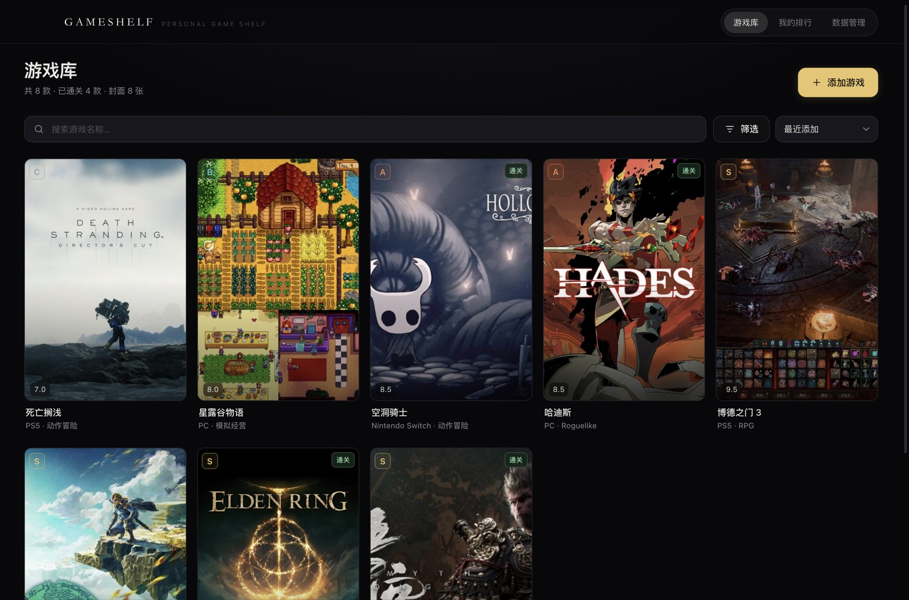
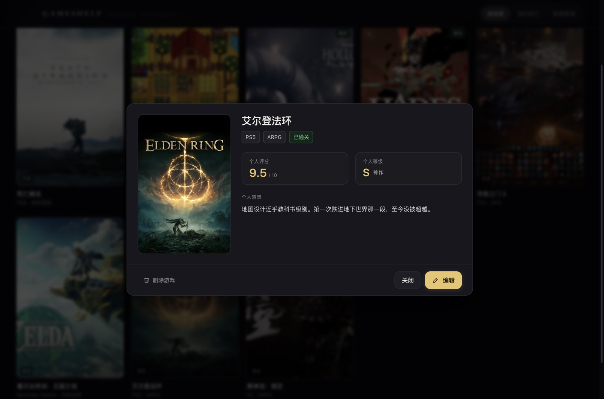
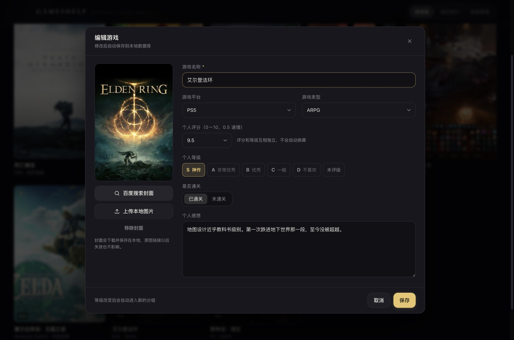
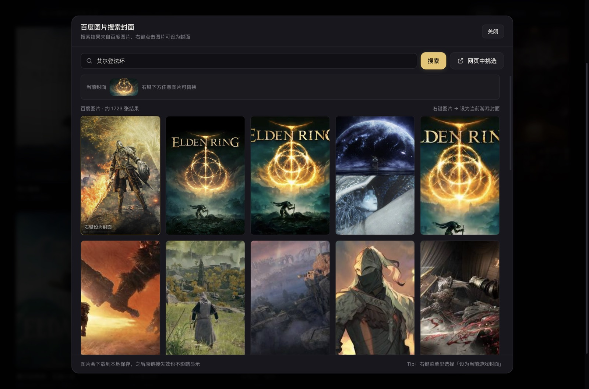
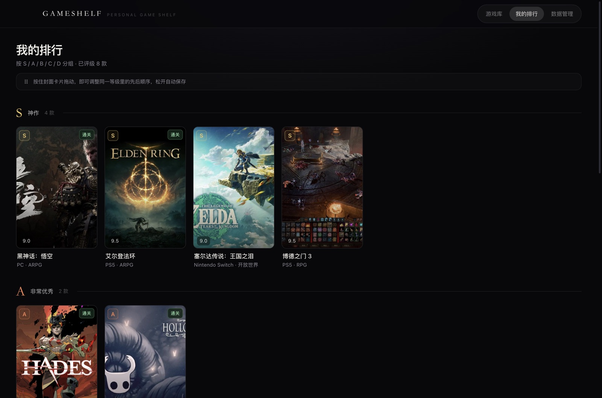
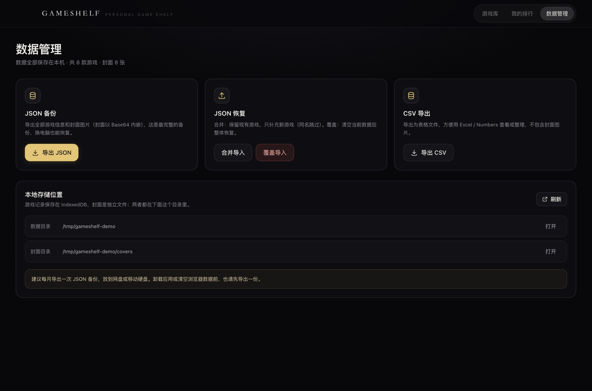

# GameShelf

**A minimal, offline personal game journal — covers, scores, grades, and a few honest words.**
**极简的离线个人游戏记录本 —— 封面、评分、等级，和几句真心话。**

<p>
  
  
  
  
  
  
  
</p>



---

## English

### What this is

GameShelf is **not** a game database, **not** a launcher, **not** a social network. It is a private notebook for the games you actually played: what it was, where you played it, what you thought, and how much you liked it. Everything stays on your own disk — no account, no server, no telemetry.

### Only eight fields

| Field | Detail |
| --- | --- |
| Title | Free text, Chinese or English — whatever you type is what gets saved |
| Cover | Picked from **Baidu Image Search**, downloaded and stored locally |
| Platform | PC, PS5, PS4, PS3, PS2, PS1, Switch, Switch 2, Xbox Series X/S, Xbox One, Xbox 360, iOS, Android, Other |
| Genre | RPG, ARPG, JRPG, Action, Action-Adventure, Open World, FPS, TPS, Strategy, Simulation, Survival-Crafting, Roguelike, Racing, Sports, Fighting, Puzzle, Rhythm, Visual Novel, Adventure, Other |
| Score | 0–10 in 0.5 steps; unrated stays "unrated" (never silently 0) |
| Grade | S / A / B / C / D, chosen by hand, fully independent from the score |
| Completed | Completed / Not completed — nothing else |
| Notes | One free-form textarea, no character limit, no extra note fields |

Nothing about publishers, release dates, playtime, achievements, tags, wishlists, friends, or Steam sync — on purpose.

### Three screens

- **Library** — a 2:3 cover wall. Instant name search, combinable filters (platform, genre, score range, grade, completion), five sort modes including your own manual ranking. Click a card for the full record.
- **My Ranking** — S/A/B/C/D groups. Drag a cover inside a group to reorder; the order is saved automatically. Change a game's grade and it moves to the end of its new group.
- **Data** — JSON backup (covers embedded as Base64), JSON restore (merge or overwrite), CSV export for Excel, plus the real storage paths with one-click open.

### Covers come from Baidu, and only Baidu

The cover picker runs a real Baidu Image Search inside a hidden Electron window (no cross-origin problem, no fabricated placeholder data), shows the actual results in a 2:3 grid, and lets you **right-click any image → "Set as current cover"**. The image is then downloaded, re-encoded to JPEG (max edge 900px) and written into `covers/`, so the original URL going dead changes nothing.

There is also a **"Pick in webpage"** mode: a real Baidu Images browser window opens, and right-clicking any image there sends it back to the form and saves it the same way.

No SteamGridDB, IGDB, RAWG, or Steam API is involved anywhere in this project.

### Run it

**macOS**

```bash
npm install
npm start          # build the renderer, then launch Electron
```

**Windows**

```powershell
npm install
npm start
```

Or just double-click `start-windows.bat` — it installs dependencies on first run (with a China-friendly Electron mirror), then builds and launches every time. Node.js 18+ required.

Optional packaging: `npm run dist` → `release/mac-arm64/GameShelf.app` (or `release/win-unpacked/` on Windows).

### Where your data lives

| | macOS | Windows |
| --- | --- | --- |
| Records (IndexedDB) | `~/Library/Application Support/GameShelf/IndexedDB/` | `%APPDATA%\GameShelf\IndexedDB\` |
| Cover files | `~/Library/Application Support/GameShelf/covers/` | `%APPDATA%\GameShelf\covers\` |

Export JSON regularly — it contains everything, covers included, and restores on another machine. The Data screen shows these paths and opens them for you.

### Stack

Electron 38 · React 18 · TypeScript · Vite 7 · Tailwind CSS 4 · native IndexedDB.

The renderer is served over a custom secure protocol (`app://gameshelf`) instead of `file://`, which is what keeps IndexedDB usable and stable. The main process handles Baidu search, image proxying/thumbnailing, cover download & re-encoding, and native file dialogs.

### Screens

| Detail | Add / edit | Baidu cover search |
| --- | --- | --- |
|  |  |  |

| Ranking | Data & backup |
| --- | --- |
|  |  |

### Tests

```bash
npm run build
node tools/e2e.cjs     # 19 end-to-end checks against a real Electron window
```

Covers: required-title guard, create/edit/delete (with confirmation), score/grade independence, detail view, search, combined filters, sorting, drag-to-reorder with persistence, reload persistence, real Baidu results, right-click cover download, JSON export / overwrite import / merge import, CSV export. Tests use a temporary profile and never touch your real library.

---

## 中文

### 这是什么

GameShelf **不是**游戏数据库，**不是**启动器，**不是**社区。它只是一本私人账本：记录你真正玩过的游戏——是什么、在哪玩的、怎么想的、有多喜欢。数据全部留在你自己的硬盘上，不要账号、不要服务器、不上传任何东西。

### 只有八个字段

| 字段 | 说明 |
| --- | --- |
| 游戏名称 | 自由文本，中英文随意，输入什么就存什么 |
| 游戏封面 | 来自**百度图片**，选中后下载并保存到本地 |
| 游戏平台 | PC、PS5、PS4、PS3、PS2、PS1、Switch、Switch 2、Xbox Series X/S、Xbox One、Xbox 360、iOS、Android、其他 |
| 游戏类型 | RPG、ARPG、JRPG、动作、动作冒险、开放世界、FPS、TPS、策略、模拟经营、生存建造、Roguelike、竞速、体育、格斗、解谜、音乐节奏、视觉小说、冒险、其他 |
| 个人评分 | 0～10 分，0.5 递增；没评分就显示「未评分」，绝不默认 0 分 |
| 个人等级 | S / A / B / C / D，必须手动选，和评分完全独立，不自动换算 |
| 是否通关 | 已通关 / 未通关，就这两个 |
| 个人感想 | 一个多行文本框，不限字数，也不拆成多个笔记字段 |

没有开发商、发行日期、时长、成就、标签、收藏夹、好友、Steam 同步——这是刻意的。

### 三个页面

- **游戏库**：2:3 封面墙。名称即时搜索，平台/类型/评分区间/等级/通关状态可自由组合筛选，五种排序（含自定义排名）。点卡片看完整记录。
- **我的排行**：S/A/B/C/D 分组展示。组内拖动封面即可调整先后顺序，松手自动保存；改了等级会自动进入新分组末尾。
- **数据管理**：JSON 备份（封面以 Base64 内嵌）、JSON 恢复（合并或覆盖）、CSV 导出，并显示真实存储路径、可一键打开。

### 封面只从百度来

选图面板在隐藏的 Electron 窗口里执行真实的百度图片搜索（因此没有跨域问题，也不会用假数据凑数），2:3 网格展示真实结果，**右键任意一张 → 「设为当前游戏封面」**。选中后下载图片、转存为 JPEG（最长边 900px）写入本地 `covers/`，原链接失效也不影响显示。

另有**「网页中挑选」**模式：打开真实的百度图片网页窗口，在网页里右键任意图片，同样会回传并保存为封面。

项目里没有 SteamGridDB、IGDB、RAWG、Steam API 的任何代码。

### 运行

**macOS**

```bash
npm install
npm start
```

**Windows**

```powershell
npm install
npm start
```

或者直接双击 `start-windows.bat`：首次自动装依赖（已配置国内 Electron 镜像），之后每次双击都会构建并启动。需要 Node.js 18+。

需要安装包时：`npm run dist` → `release/mac-arm64/GameShelf.app`（Windows 上为 `release/win-unpacked/`）。

### 数据在哪

| | macOS | Windows |
| --- | --- | --- |
| 记录（IndexedDB） | `~/Library/Application Support/GameShelf/IndexedDB/` | `%APPDATA%\GameShelf\IndexedDB\` |
| 封面文件 | `~/Library/Application Support/GameShelf/covers/` | `%APPDATA%\GameShelf\covers\` |

记得定期导出 JSON——它包含全部数据（连封面一起），换电脑也能完整恢复。数据管理页会直接显示这两个路径。

### 技术栈

Electron 38 · React 18 · TypeScript · Vite 7 · Tailwind CSS 4 · 原生 IndexedDB。

渲染层通过自定义安全协议 `app://gameshelf` 加载而不是 `file://`，这是 IndexedDB 能稳定工作的关键。主进程负责百度搜索、图片代理与缩略图、封面下载与转码、原生文件对话框。

### 测试

```bash
npm run build
node tools/e2e.cjs     # 19 项端到端检查，真实驱动 Electron 窗口
```

覆盖：名称必填拦截、新增/编辑/删除（二次确认）、评分与等级独立、详情、搜索、组合筛选、排序、等级内拖动并持久化、刷新后数据仍在、百度真实结果、右键下载封面、JSON 导出/覆盖导入/合并导入、CSV 导出。测试使用临时配置目录，不会碰你的真实数据。
